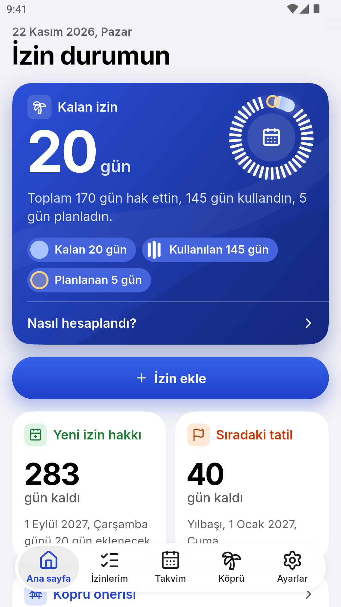
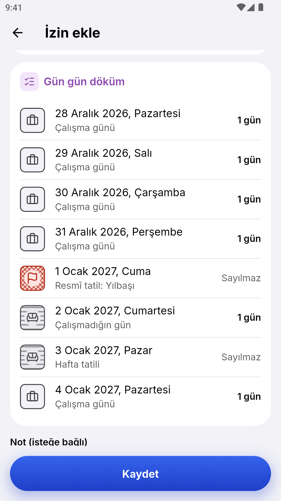
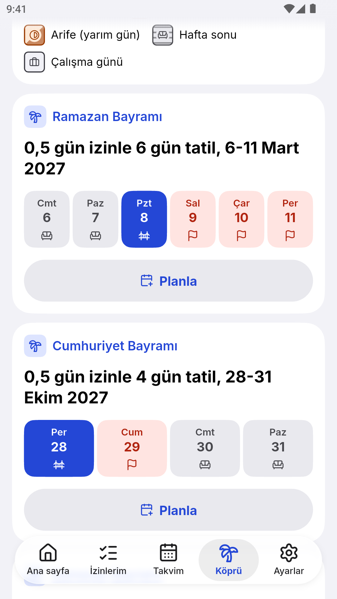
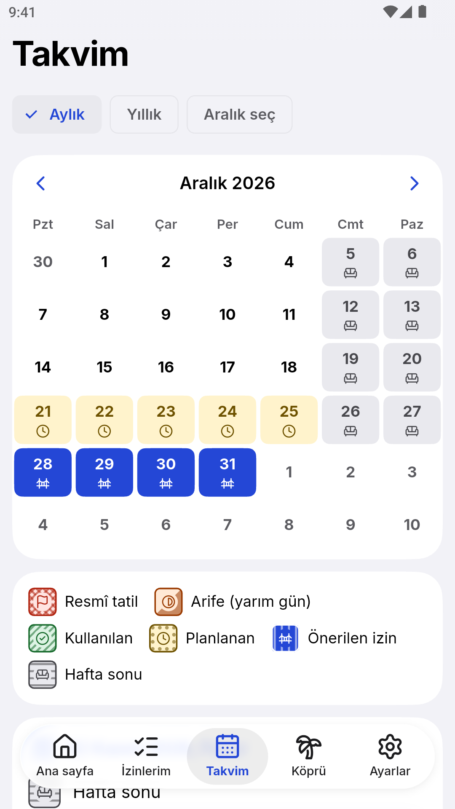

# İzin Planla

[](https://github.com/mobilteknolojileri/izin-planlayici-mobil/actions/workflows/ci.yml)
[](LICENSE)

Türkiye'deki çalışanlar için yıllık izin hesaplama, izin takibi ve köprü tatil planlama uygulaması. Android için Flutter ile geliştiriliyor.

> Google Play'de kapalı test aşamasında, henüz herkese açık değil.

## Ne yapar

- İş Kanunu (4857) ve Devlet Memurları Kanunu (657) çalışanlarının yıllık izin hakkını kıdeme ve yaşa göre hesaplar. Her sonucun yanında hangi kuralın, hangi maddeye göre uygulandığını gösterir.
- İzin kaydında düşülecek günü gün gün hesaplar: hafta tatili, resmî tatil, arife ve cumartesi ayarı dâhil.
- Resmî tatillere göre en verimli köprü günlerini önerir, kalan izin bakiyesine göre yıllık plan çıkarır.
- Birden fazla kişiyi takip eder, takvim, istatistik, hatırlatma, ana ekran widget'ı ve PDF, Excel, CSV dışa aktarma sunar.

## Ekran görüntüleri

<p>
  
  
  
  
</p>

## Gizlilik

Uygulama internet izni istemez. Hesap, reklam ve analitik yoktur. Bütün veriler sadece cihazda saklanır, hiçbir sunucuya gönderilmez. Uygulamanın istediği tek izin bildirim izni, o da kullanıcı bir hatırlatmayı açtığında sorulur.

## Hesap kuralları

Her hesap kuralı [`docs/mevzuat.md`](docs/mevzuat.md) dosyasındaki resmî bir kaynağa bağlıdır. Mevzuatın açık olmadığı yerler aynı dosyada ve uygulama içinde belirtilir.

## Yasal uyarı

İzin Planla bağımsız bir uygulamadır. Resmî bir uygulama değildir, hiçbir kamu kurumuyla bağlantısı yoktur. Bilgilendirme amaçlıdır, hukuki tavsiye değildir. Hesaplar `docs/mevzuat.md` dosyasındaki kaynaklara ve o dosyanın son güncellendiği tarihteki mevzuata dayanır. Mevzuat ve yargı kararları değişebilir, uygulama hata içerebilir. Kesin bilgi için işverenine, insan kaynaklarına veya bir hukukçuya danış. Uygulama hiçbir garanti verilmeden sunulur. Kullanımından doğan sonuçlardan, yasaların izin verdiği ölçüde, geliştirici sorumlu tutulamaz (GPL-3.0 madde 15 ve 16).

## Derleme

Gerekenler: Flutter 3.50.1 (stable) ve Android SDK. Sürümler [`docs/araclar.md`](docs/araclar.md) içinde.

```sh
flutter pub get
flutter run
```

Üretilen dosyalar (`*.g.dart`, `*.freezed.dart`, `lib/l10n/gen/`) repoda bulunur, ilk derleme için kod üretimi gerekmez.

## Katkı

Klasör yapısı, commit kuralları ve hook kurulumu [`CONTRIBUTING.md`](CONTRIBUTING.md) dosyasında. Proje dokümanları [`docs/`](docs/README.md) altında.

## Lisans

[GPL-3.0](LICENSE). Bu kodu kullanan ve dağıtan herkes kendi sürümünün kaynak kodunu da aynı lisansla açmak zorundadır.

---

## English

İzin Planla is an Android app for employees in Türkiye. It calculates annual leave entitlement under Labour Law 4857 and Civil Servants Law 657, tracks leave with a day-by-day breakdown and suggests bridge holidays around official holidays. Everything stays on the device: no internet permission, no account, no ads, no analytics. The app is in Turkish only. Built with Flutter, licensed under GPL-3.0. It is an independent app, not an official one, and has no link to any public institution. It is for information only, not legal advice, and comes without any warranty (GPL-3.0 sections 15 and 16).
